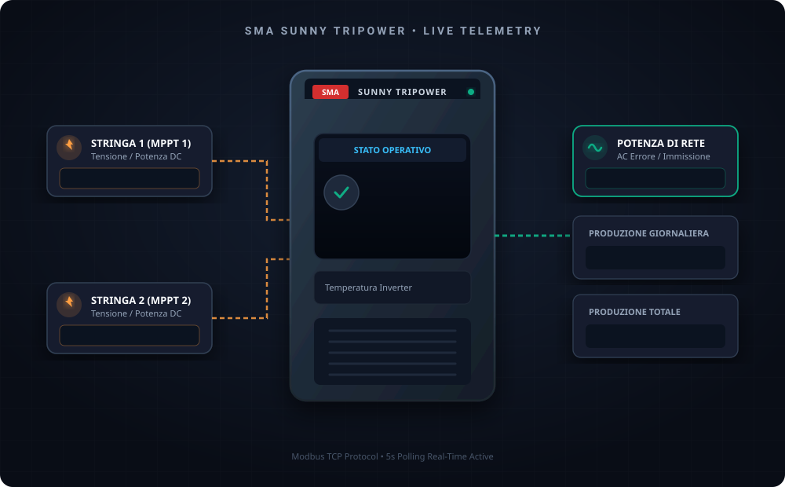

# 📊 Dashboard Vettoriale per Inverter SMA Sunny Tripower

Questa guida illustra come configurare una dashboard Lovelace avanzata con **grafica vettoriale interattiva (SVG)** per monitorare in tempo reale il flusso energetico dell'inverter SMA Sunny Tripower.

  

---

## ⚡ Caratteristiche
- **Grafica Vettoriale SVG ad alta risoluzione**: scala perfettamente su smartphone, tablet e monitor da parete.
- **Valori in Tempo Reale Sovrapposti**:
  - Potenza DC delle stringhe MPPT (Stringhe A/B o C/D) in ingresso.
  - Potenza AC di rete immessa in uscita.
  - Stato operativo (OK, Spento, Attenzione, Errore) visualizzato sul display LCD centrale.
  - Temperatura interna dell'inverter.
  - Produzione energetica giornaliera e totale.
- **Gauge e Indicatori di Rendimento**: indicatori a lancetta per monitorare la potenza istantanea e la temperatura con soglie di allerta cromatiche.
- **100% Nativo**: non richiede componenti custom esterni complessi; utilizza la scheda nativa `picture-elements` di Home Assistant.

---

## 🛠️ Istruzioni di Installazione Passo-Passo

### 1. Copia l'immagine vettoriale in Home Assistant
1. Prendi il file [`images/sma_inverter_vector.svg`](images/sma_inverter_vector.svg).
2. Copialo nella cartella **`www`** della tua installazione di Home Assistant:
   - Percorso: `/config/www/sma_inverter_vector.svg`
   *(Nota: Se la cartella `www` non esiste all'interno di `config`, creala e riavvia Home Assistant affinché l'endpoint `/local/` sia attivo).*
3. Verifica aprendo nel browser del tuo computer o telefono l'indirizzo:  
   `http://<IP_HOME_ASSISTANT>:8123/local/sma_inverter_vector.svg` (dovrà visualizzare l'inverter).

---

### 2. Aggiungi la Scheda in Lovelace
1. Apri la tua Dashboard in **Home Assistant**.
2. Clicca sui **3 puntini in alto a destra** ➔ **Modifica Dashboard**.
3. Clicca su **Aggiungi scheda** in basso a destra.
4. Scorri fino in fondo e seleziona **Manuale** (scheda in formato codice YAML).
5. Apri il file con il codice pronto [examples/lovelace_sma_dashboard.yaml](examples/lovelace_sma_dashboard.yaml), copiane il contenuto e incollalo nell'editor.
6. Clicca su **Salva**.

---

### 💡 Personalizzazione per Inverter 1 vs Inverter 2

A seconda di quale inverter stai visualizzando, verifica i nomi delle entità nel codice YAML:

- **Per Inverter 1 (Stringhe C e D)**:
  - Stringa 1: `sensor.inverter_1_potenza_fv_c`
  - Stringa 2: `sensor.inverter_1_potenza_fv_d`
  - Rete: `sensor.inverter_1_potenza_di_rete`
  - Stato: `sensor.inverter_1_stato`
  - Resa Giorno: `sensor.inverter_1_produzione_giornaliera`
  - Resa Totale: `sensor.inverter_1_produzione_totale`

- **Per Inverter 2 (Stringhe A e B)**:
  - Stringa 1: `sensor.inverter_2_potenza_fv_a`
  - Stringa 2: `sensor.inverter_2_potenza_fv_b`
  - Rete: `sensor.inverter_2_potenza_di_rete`
  - Stato: `sensor.inverter_2_stato`
  - Resa Giorno: `sensor.inverter_2_produzione_giornaliera`
  - Resa Totale: `sensor.inverter_2_produzione_totale`
